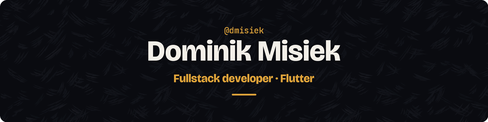
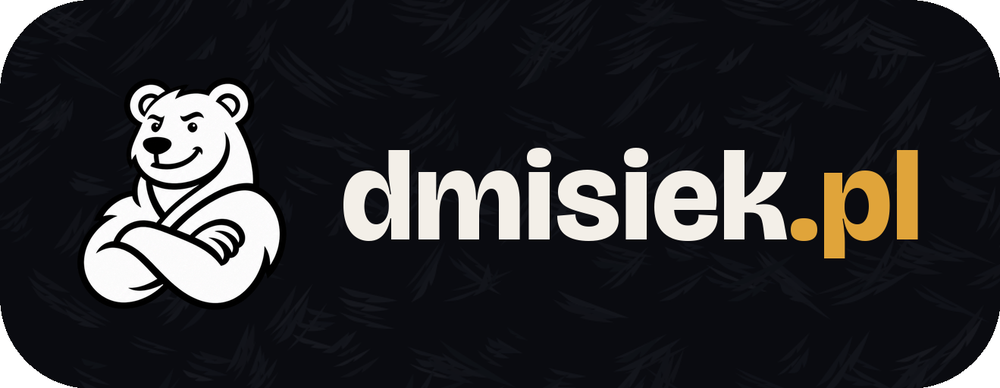
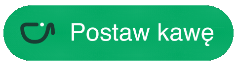
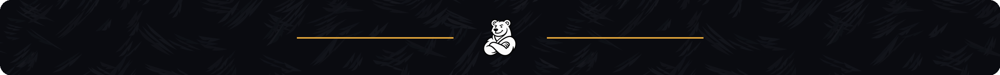

### Hi there 👋

I build mobile apps in Flutter for a living, from the first idea to the store release. I started out in web frontend and
picked up backend through my own projects.

After hours I build my own tools from start to finish to solve real problems. Side projects are my testing ground: I try
out new technologies, experiment, and learn what you only learn by maintaining an app that people actually use.

⚡ Fun fact: my programming journey began with a simple stats page for Dead by Daylight. It grew into Dead by Stats, and
✨ it just happened ✨

### 🧸 Main projects

**[Mój Pellet](https://mojpellet.dmisiek.pl/)** · mobile app ·
2026 · [Google Play](https://play.google.com/store/apps/details?id=pl.mypellet.app) 
A pellet heating log for boilers without sensors: real consumption analysis, stock tracking that tells you when you'll
run out, and maintenance reminders.

**[RynekGPU](https://rynekgpu.dmisiek.pl/)** · web app · since 2022 
Graphics card price tracker for the largest Polish stores. Prices collected three times a day, with history and min /
median / max compared against MSRP.

**[Dead by Stats](https://deadbystats.eu/)** · web app · 2022–2024 
Dead by Daylight stats for any public Steam profile, with global leaderboards for 200+ stats. 12M+ lookups, 120K tracked
players.

### 🛠️ What I work with

   

### 📬 Find me

✉️ [dmisiek.dev@gmail.com](mailto:dmisiek.dev@gmail.com)

  
  &nbsp;
  
  &nbsp;
  

### ☕ Support

